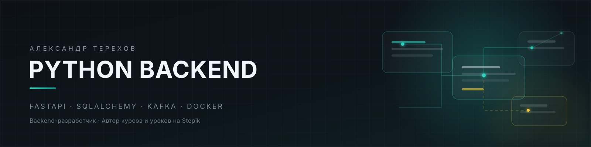

  

# Александр Терехов

**Backend-разработчик на Python** · автор курсов и уроков на Stepik

Пишу API и сервисы на FastAPI, проектирую архитектуру и преподаю то, что использую в работе.

## О себе

Работаю с FastAPI, и асинхронным SQLAlchemy 2.0, проектирую сервисы по принципам Clean Architecture. Автор курсов и уроков на Stepik — около 2 000 студентов.

## Стек

| Направление | Технологии |
| :--- | :--- |
| Язык и фреймворки | Python, FastAPI, Django, DRF, Pydantic |
| Данные | SQLAlchemy 2.0, Alembic, PostgreSQL, Redis |
| Очереди и события | FastStream, RabbitMQ, Kafka, NATS, Celery, Taskiq |
| Архитектура | Clean Architecture, DDD, Dishka, Unit of Work |
| Инфраструктура | Docker, Docker Compose, Poetry, Nginx, GitHub Actions |

## Курсы на Stepik

**Основной курс** — [Python Backend: FastAPI, SQLAlchemy, RabbitMQ, Kafka, NATS](https://stepik.org/a/223717)
Полный путь в бэкенд: FastAPI, FastStream, Dishka, SQLAlchemy, RabbitMQ, NATS, Kafka, Celery, Taskiq, Redis, Docker, Poetry, DRF, Pydantic.

**Отдельные модули:**

| Курс | О чём |
| :--- | :--- |
| [SQLAlchemy 2.0: от новичка до эксперта](https://stepik.org/a/299401) | Sync и async ORM, связи таблиц, стратегии загрузки, каскады, Alembic, N+1, транзакции |
| [FastStream + FastAPI: event-driven](https://stepik.org/a/299578) | Единый API для RabbitMQ, Kafka, NATS и Redis: воркеры, сериализация, тесты, метрики |
| [Dishka: DI без боли](https://stepik.org/a/299533) | IoC-контейнер, провайдеры, скоупы, финализация, чистая архитектура в FastAPI |
| [Чистая архитектура на практике](https://stepik.org/course/276482/promo) | Проектирование систем на FastAPI: слои, зависимости, тестируемость — бесплатно |
| [Интеграция с SaaS: Pyrus, FastAPI и вебхуки](https://stepik.org/course/304093/promo) | REST, вебхуки, Extensions API и сервис-мост между Pyrus и Telegram — бесплатно |

## Избранные проекты

| Проект | Описание |
| :--- | :--- |
| **[tutors-platform](https://github.com/musecollaboration/tutors-platform)** | Платформа для поиска репетиторов и проведения занятий. Бэкенд на FastAPI, модульный монолит |
| **[pyrus-telegram-chat](https://github.com/musecollaboration/pyrus-telegram-chat)** | Сервис-мост между задачами Pyrus и Telegram-чатом: сообщения ходят в обе стороны |
| **[MiniERP](https://github.com/musecollaboration/MiniERP)** | Модуль бухгалтерского учёта с двойной записью, OCR документов и микросервисной архитектурой |
| **[ClientSync](https://github.com/musecollaboration/ClientSync)** | Агрегация клиентских данных: enterprise-подходы к архитектуре, масштабированию и производительности |

## Контакты

- Telegram: [@musecollaboration](https://t.me/musecollaboration)
- Stepik: [профиль автора](https://stepik.org/users/659009172/teach)
- GitHub: [musecollaboration](https://github.com/musecollaboration)

Открыт к предложениям.
